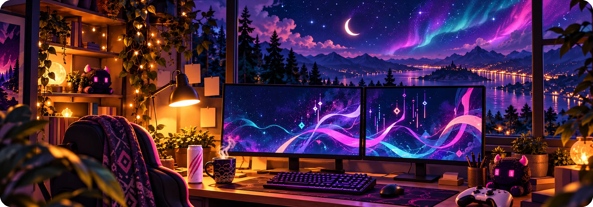

 

## 🚀 Featured projects

<table>
<tr>
<td width="50%" valign="top">

### [G-Tools](https://karthus3560.github.io/g-scanner-releases/)
**The office suite that runs without internet** · أدوات مكتبك اليومية

Scanning, a Word-style print studio, PDF tools, correspondence and finance archives, and encrypted office chat, all in one Arabic-first Windows app.

`Windows` `Arabic RTL` `Offline` · [Website](https://karthus3560.github.io/g-scanner-releases/) · [Download](https://github.com/Karthus3560/g-scanner-releases/releases/latest)

</td>
<td width="50%" valign="top">

### [Kinship Studio](https://github.com/Karthus3560/monster-hunter-stories-2-trainer)
**Monster Hunter Stories 2 · native Camp-menu mod**

A Windows launcher that finds Steam, starts the game and loads the mod into the game's own menus. Battles, exploration, rewards, egg hunting, profiles and save backups.

`C#` `.NET` `WPF` · [Website](https://karthus3560.github.io/monster-hunter-stories-2-trainer/) · [Download](https://github.com/Karthus3560/monster-hunter-stories-2-trainer/releases/latest)

</td>
</tr>
<tr>
<td width="50%" valign="top">

### [Hypnophobia — Arabic Patch](https://github.com/Karthus3560/hypnophobia-from-your-shadow-arabic-patch)
**تعريب كامل · full story translation**

All six chapters in Arabic with proper right-to-left text, inside a small pixel-art patch app that detects Steam and installs or removes the patch cleanly.

`Localization` `RTL` `WPF` · [Website](https://karthus3560.github.io/hypnophobia-from-your-shadow-arabic-patch/) · [Download](https://github.com/Karthus3560/hypnophobia-from-your-shadow-arabic-patch/releases/latest)

</td>
<td width="50%" valign="top">

### [Arabic Voice Studio](https://github.com/Karthus3560/arabic-voice-studio)
**Emotive Arabic and English speech, fully offline**

Every line gets its own emotion, with real laughs and sighs in the cloned voice and voice swaps mid-script. Packaged as a Claude Code skill with a video demo.

`Python` `TTS` `Offline AI`

</td>
</tr>
<tr>
<td width="50%" valign="top">

### [Crewroom](https://karthus3560.github.io/crewroom/)
**Your AI team, together**

Claude Code and OpenAI Codex working as one team on Windows: a shared mailbox, hand-offs, and a window to watch them collaborate.

`Python` `AI agents` · [Website](https://karthus3560.github.io/crewroom/)

</td>
<td width="50%" valign="top">

### [Folder Icon Studio](https://github.com/Karthus3560/folder-icon-studio)
**Change Windows folder icons, beautifully**

Drag and drop, 800+ built-in icons and a glassy dark UI. One EXE, no install, no admin rights.

`Windows` `Desktop app` · [Download](https://github.com/Karthus3560/folder-icon-studio/releases/latest)

</td>
</tr>
<tr>
<td width="50%" valign="top">

### [Neon 2048](https://github.com/Karthus3560/neon-2048)
**2048 with sticker tiles and arcade music**

Every tile is its own animated sticker on a glowing board, with power-ups and a soundtrack. Arrow keys or swipes.

`TypeScript` · [Play it in your browser](https://karthus3560.github.io/neon-2048/)

</td>
<td width="50%" valign="top">

### More to explore

🏠 **[Cozy Tasks](https://github.com/Karthus3560/cozy-tasks)** · a cozy household app for groceries, wishlists and a shared budget.

🟦 **[Palbox Square Guide](https://github.com/Karthus3560/palworld-square-guide)** · a Palworld mod that draws a square building guide inside the Palbox, no UE4SS needed.

🎨 **UI design systems** · four styles as AI-agent skills, right below.

</td>
</tr>
</table>

## 🎨 UI design systems

Four design styles, each packaged as an AI-agent skill with interactive HTML labs you can click through.

<table>
<tr>
<td align="center" width="25%"> <b>Glassmorphism</b> frost on a nebula</td>
<td align="center" width="25%"> <b>Neumorphism</b> soft clay shadows</td>
<td align="center" width="25%"> <b>Royal</b> obsidian and 24K gold</td>
<td align="center" width="25%"> <b>Blood Red</b> oxblood and damask</td>
</tr>
</table>

## 🧰 What I work with

 

**Desktop & games:** C#, .NET, WPF, game modding, Steam integration 
**Web & apps:** TypeScript, React, Vite, Firebase 
**Tools & AI:** Python, PowerShell, offline speech, multi-agent workflows 
**Languages:** Arabic and English, including right-to-left UI and localization

## 🐍 Contributions, eaten

<picture>
  <source media="(prefers-color-scheme: dark)" srcset="https://raw.githubusercontent.com/Karthus3560/Karthus3560/output/snake-dark.svg" />
  <source media="(prefers-color-scheme: light)" srcset="https://raw.githubusercontent.com/Karthus3560/Karthus3560/output/snake.svg" />
  
</picture>

## بالعربية

أهلاً، أنا **غيث**.

أصنع تطبيقات ويندوز، وتعديلات للألعاب، وتعريبات كاملة للألعاب. في النهار أبني أنظمة للموارد البشرية والقطاع الصحي، وفي وقت فراغي أصنع أدوات للألعاب التي أحبها.

- **[G-Tools](https://karthus3560.github.io/g-scanner-releases/):** أدوات المكتب اليومية في تطبيق واحد: المسح، أستوديو الطباعة، أدوات PDF، الأرشيف والمحادثات، وكلها بدون إنترنت.
- **[تعريب Hypnophobia: From Your Shadow](https://github.com/Karthus3560/hypnophobia-from-your-shadow-arabic-patch):** ترجمة عربية كاملة للفصول الستة، مع دعم صحيح للكتابة من اليمين إلى اليسار، وتطبيق صغير يثبّت التعريب ويزيله بأمان.
- **[Arabic Voice Studio](https://github.com/Karthus3560/arabic-voice-studio):** نطق عربي بمشاعر مختلفة لكل سطر، مع ضحكات وتنهدات حقيقية، يعمل بالكامل بدون إنترنت.
- **[Kinship Studio](https://github.com/Karthus3560/monster-hunter-stories-2-trainer):** تعديل للعبة Monster Hunter Stories 2 يعمل من داخل قوائم اللعبة نفسها.
- **[Folder Icon Studio](https://github.com/Karthus3560/folder-icon-studio):** تطبيق لتغيير أيقونات المجلدات في ويندوز بالسحب والإفلات، مع أكثر من 800 أيقونة.

إن وجدت مشكلة أو أردت اقتراح شيء، افتح Issue في المشروع.

